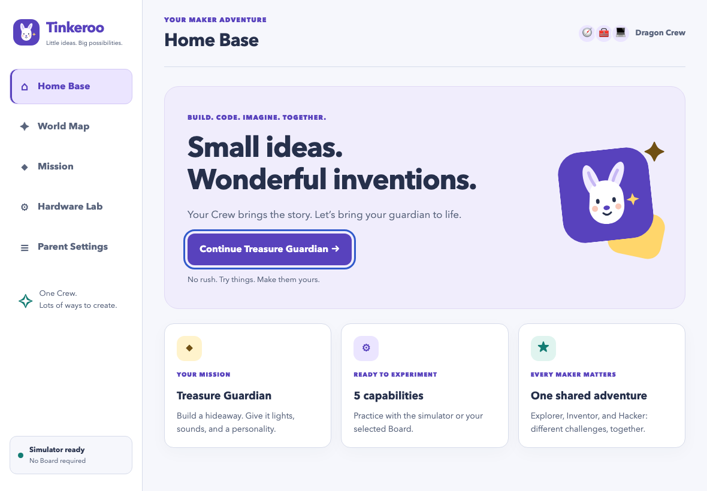

# Tinkeroo

**Build. Code. Imagine. Together.**

A local-first cooperative maker game for one family Crew: build LEGO creations, give them behavior with an Arduino UNO Q, and explore Missions together. The macOS app uses Tauri 2, Rust, and Svelte/TypeScript.

> **Development preview:** the current implementation is on `main`. Simulator play is available without hardware. Physical UNO Q/family acceptance and public release signing/notarization are not complete. Hybrid setup software retains explicit official first-account/firmware-start handoffs; unsupported whole-baseline migrations are not attempted. No production installer has been validated yet.

## Start here

| You want to… | Use this path |
| --- | --- |
| Try a Mission immediately, without hardware | [Open the browser prototype](#try-it-without-installing-anything) |
| Run the native Mac app today | [Build locally](#build-and-run-from-source); public installers are not ready |
| Replace an older Mac app | [Upgrade the Mac app](#upgrade-the-mac-app) — manual, parent-approved |
| Use a real UNO Q | [Connect the Board](#connect-an-arduino-uno-q); official first-time setup is still required |
| Update an installed Board's Linux runtime | [Board runtime updates](#upgrade-the-boards-companion-runtime) — **not** a Mac app upgrade |

## Try it without installing anything

Clone/download `main` and open [`prototypes/treasure-guardian.html`](prototypes/treasure-guardian.html) directly in a browser. This throwaway prototype is one self-contained file: no account, backend, installation, or Board is required.

For family feedback, use the [play-test guide](prototypes/treasure-guardian-playtest.md) and [findings template](prototypes/treasure-guardian-findings.md). Automated checks are not a substitute for a real family play test.

## Install the macOS app

### Public releases — not available/validated yet

When an owner-approved signed/notarized release is published, download the appropriate `.dmg` from [GitHub Releases](https://github.com/josebarrueta/tinkercrew/releases), open it, and drag **Tinkeroo** to **Applications**. Public release preparation targets Universal 2 (Apple silicon and Intel), macOS 12+; actual Intel/clean-Mac acceptance remains pending.

Do not disable Gatekeeper or remove quarantine to declare an installation successful. Current development/CI artifacts are **ad-hoc signed, not Developer-ID-signed or notarized**, and may be blocked when downloaded. They are for developer testing, not a production installer. Build locally using the instructions below if you need to try the native app now.

### CI development downloads

After a successful run of [macOS CI](https://github.com/josebarrueta/tinkercrew/actions/workflows/ci-macos.yml), open the run's **Artifacts** section and download `tinkeroo-macos-ARCH-COMMIT` (GitHub sign-in may be required). Extract the Actions archive; it contains a DMG, an app ZIP that preserves bundle metadata/symlinks, and `SHA256SUMS.txt`.

CI builds the runner's **native architecture**, identified in the artifact name and DMG filename—not a validated Universal release. Check the workflow/ref/commit before downloading; PR artifacts are untrusted development outputs. Hashes detect corruption, not publisher authenticity. Production signature verification is a separate release gate.

Build downloads expire after **14 days**; QA reports and failed browser-test diagnostics after **7 days**. Re-run CI or build locally after expiry. GitHub Actions artifacts are temporary storage; approved public installers belong in GitHub Releases, not git or Git LFS.

## Upgrade the Mac app

**A working manual upgrade path is provided; there is no automatic/in-app installer.** In the native app, open **Board Setup → Upgrade the Mac app → Open official Mac app releases**. This pauses/disconnects this Mac's gameplay and opens only the [official Releases page](https://github.com/josebarrueta/tinkercrew/releases); it does not download/install anything or change the Board. Resolve pending Board maintenance before upgrading.

1. Choose a **newer, owner-approved** release for your Mac's architecture/macOS, read its release notes, and follow the [release trust/verification guidance](docs/release/macos.md#signed-application-update-design). No public signed/notarized installer is available/validated yet. Development/PR artifacts are not a substitute for an approved release.
2. Stop the Mission, disconnect the Board, and **quit Tinkeroo completely**. Never quit or upgrade during an active factory restore.
3. Back up needed progress using your normal Mac backup. Native data is under `~/Library/Application Support/com.tinkercrew.desktop/`; copy it only while the app is quit. Keep existing macOS Keychain entries; do not export credentials to shareable files.
4. Open the new DMG and drag **Tinkeroo.app** to **Applications**, choosing **Replace** for the old app. Replace only the application bundle: do **not** delete app data, use Forget, clear Keychain, or reset/reflash the Board. Never disable Gatekeeper or remove quarantine; stop if macOS rejects the download.
5. Reopen the app, check the displayed version and your Crew/progress, and reconnect/rearm explicitly when ready. Existing storage/Keychain identifiers are retained; real upgrade/reinstall acceptance remains pending. If progress is unreadable, preserve the backup and report the error rather than resetting it or blindly downgrading.

### Upgrade a locally built development app now

With the [prerequisites below](#prerequisites) installed, quit the old app and run from your existing checkout:

```sh
git status --short       # STOP if this lists changes; preserve/commit them first
# The && chain stops if checkout, pull, install, or build fails.
git switch main &&
git pull --ff-only &&
npm --prefix app ci &&
npm --prefix app run build:dmg &&
codesign --verify --deep --strict app/src-tauri/target/release/bundle/macos/Tinkeroo.app
```

Install the newly built app/DMG by replacing the old bundle as above. Development builds may share the version `0.1.0`; record the source commit (`git rev-parse --short HEAD`) or CI artifact commit, not just the version. A local development build is ad-hoc signed, **not** notarized or approved for general distribution. [CI downloads](#ci-development-downloads) remain developer-only and can be blocked by Gatekeeper; a trusted local build or an approved release is the supported alternative, not a bypass.

## Build and run from source

### Prerequisites

- macOS **12 or newer**; development uses your Mac's native architecture.
- Xcode Command Line Tools: `xcode-select --install` (complete Apple's installation prompt).
- Current stable Rust with `cargo`, `rustfmt`, and `clippy`. With [rustup](https://rustup.rs/): `rustup component add rustfmt clippy`.
- Node.js **22.12+** recommended (Node **20.19+ within the 20.x line** is also supported).
- Python **3.11+** and OpenSSL **3** for the combined software checks and release tooling (for example `brew install openssl@3`; put the formula's `bin` on PATH for identity tests). Normal installed Mac gameplay does not require local Python/OpenSSL.
- Git. Internet is needed to obtain dependencies/browser binaries initially, not for installed simulator gameplay.

```sh
git clone https://github.com/josebarrueta/tinkercrew.git
cd tinkercrew/app
npm ci
npm run dev:app
```

The app starts in Simulator mode: no UNO Q, cloud account, or credentials are required. `npm run dev` launches the browser-only frontend instead; its non-secret localStorage progress is separate from the native app's SQLite progress.

### Create the app and installer

From `app/`:

```sh
npm run build:app  # native-architecture release-mode .app
npm run build:dmg  # .app plus headless drag-to-Applications DMG
```

Outputs:

- `app/src-tauri/target/release/bundle/macos/Tinkeroo.app`
- `app/src-tauri/target/release/bundle/dmg/Tinkeroo_VERSION_ARCH.dmg`

Open your local `.app`, or copy it to Applications for local testing. “Release mode” means an optimized build, **not** a production-signed/notarized release. Both development build scripts explicitly seal/sign the bundle ad-hoc using `tauri.development.conf.json`; CI verifies the strict resource seal. This separate configuration is not used by the protected Developer ID release workflow. The DMG script sets `CI=true` to avoid interactive Finder layout automation while preserving the Applications link.

For Universal builds, production signing/notarization, owner-provided secrets, detached update signatures, and clean-Mac gates, see the [release procedure](docs/release/macos.md). Routine CI never receives signing credentials, publishes releases, or updates a Board.

## Tests and CI

After `npm ci`, install the test browser once and run from the repository root:

```sh
python3 -m venv .venv
.venv/bin/python -m pip install -r companion/python/requirements-auth.txt
cd app
npx playwright install chromium
cd ..
bash scripts/check-mvp.sh --build
```

The check script reuses `.venv` when present; it never installs packages itself. Activate it (`source .venv/bin/activate`) before running native/Python authentication tests directly. The new tests use real loopback TLS and temporary keys/registries, not actual hardware or user Keychain.

This runs frontend/type/format/lint checks, Rust persistence and real loopback TLS tests, Python Companion tests, browser Mission/recovery tests, release metadata/signature checks, and an app build. Reports go to ignored `artifacts/qa/` and record toolchain versions and pass/fail results. To skip the app build, omit `--build`.

[macOS CI](.github/workflows/ci-macos.yml) runs on pushes, pull requests, and manual dispatch. It runs these software checks, builds the development DMG, verifies its read-only app/Applications-link layout, and retains the outputs described above. The separate [production release workflow](.github/workflows/release-macos.yml) is manual, protected, credential-dependent, and creates drafts only.

Physical Board, actual ADB/Bonjour/VPN, electrical safe-off timing, family play-testing, and notarization acceptance remain separate. See the [QA/recovery matrix](docs/qa/recovery-safety.md).

## Connect an Arduino UNO Q

Simulator mode is the easiest first step. For hardware play:

1. Separately install official [Android Platform-Tools](https://developer.android.com/tools/releases/platform-tools) (Arduino documents `brew install android-platform-tools`). Tinkeroo does **not** bundle Google's binaries or accept their license for you. `TC_ADB_PATH` may point to an absolute `adb` executable.
2. Open **Board Setup → Set up a UNO Q — resumable official-tool handoff guide**, select the exact physical USB Board, and follow the supported official first-account/name/password/Wi-Fi/SSH handoffs. Enable SSH explicitly even for dedicated-key verification over USB; full restart proof also needs LAN. No account/password or unknown system configuration is guessed.
3. On the supported configured baseline, **Prepare initial Companion files and identity** can resume/verify its fixed absent-target source and private Board-side TLS identity without overwriting an existing app/configuration. Explicitly start the selected [UNO Q Companion](companion/README.md) in official App Lab; first start can upload MCU firmware and stop another app. Review backups/loads/target first. See the [preparation and renewal contract](docs/architecture/initial-provisioning.md); unknown whole-baseline upgrades remain a handoff, never a speculative overwrite.
4. Continue the [resumable guide](docs/architecture/setup-checkpoints.md): native Pairing verifies restricted SSH plus signed TLS, runtime proof verifies only a compatible compiled bundle, tracked restart requires a new kernel plus LAN/USB observations, and fresh bounded hardware/input evidence precedes saving the Crew. Checkboxes alone cannot complete those stages; completion never reconnects/rearms. The [legacy provisioned-record import](docs/architecture/board-connections.md) remains a separate development bridge, not setup proof.

UNO Q maker GPIO is **3.3 V**; never apply 5 V to analog inputs. Disconnect power before changing wiring. Follow the in-app safety panel and pending [physical acceptance plan](docs/qa/recovery-safety.md).

## Upgrade the Board's Companion runtime

This is **separate from upgrading Tinkeroo on the Mac**. On an already installed, compatible, supervised TBP baseline, use **Board Setup → Recoverable Linux runtime update**:

1. Connect/select the physical USB Board, inspect its hardware serial, and select its registered Board profile.
2. Confirm the exact Board, type `UPDATE <hardware serial>`, and choose **Update / resume bundled Linux runtime**. Only the runtime bundled with this Mac app is eligible; there is no arbitrary archive installer.
3. Wait for authenticated disarmed trial health and the reported committed outcome. Interruption or a failed trial must be inspected/resumed or explicitly aborted; never assume disconnect means success. No automatic reconnect/rearm follows.

This does not install the initial baseline, change credentials/dependencies/firmware, or flash the OS. Unsupported contracts require the supported official setup handoff. Actual UNO Q update/rollback acceptance is still NOT RUN. See the [runtime contract and recovery limitations](docs/architecture/runtime-updates.md).

## Board Setup and recovery

**Board Setup** replaces Parent Settings and brings connections, existing-Board Linux authentication, hostname/Wi-Fi configuration, scheduled restart, local pairing cleanup, and guarded factory restore into one hub. Linux passwords are request-only, never saved. Management pauses gameplay.

Factory restore is a **destructive Linux OS reflash**, not a restart or checkpoint reset. It requires a separately installed official Arduino Flasher CLI **0.5.4**, an inspected physical Board, exact version/checksum, backup/EDL/power acknowledgements, and `ERASE <hardware serial>`. Actual hardware acceptance is **pending**; no reset was performed during development. The hybrid guide now integrates protected Pairing/runtime/restart/hardware/Crew proofs, but retains official first-account/firmware-start handoffs and has not passed reset-Board acceptance; it is not one-click onboarding. See the [Board Setup workflow, safety boundaries, and recovery evidence](docs/architecture/board-setup.md).

## Tinkeroo look and feel



Tinkeroo shares the playful “roo” family naming theme with Rallyroo. Its calm lilac/white workspace uses purple for the next action, teal for supportive cues, and small sunshine/coral accents. Hardware green/yellow/red signals and amber safety warnings keep their meaning. No flashing, autoplay, confetti, or external font downloads compete with building. See the [brand and accessibility guide](docs/design/tinkeroo-theme.md).

The GitHub repository remains `josebarrueta/tinkercrew`. Existing bundle identity, Keychain entries, saved progress, Board discovery names, and protocol identifiers intentionally retain their legacy names so this visual rename does not reset a Crew or break a paired Board.

## Project guides

- [App architecture and playable Mission](app/README.md)
- [Companion installation, API, and tests](companion/README.md)
- [Board Setup management and destructive recovery](docs/architecture/board-setup.md)
- [Resumable hybrid setup and native evidence gates](docs/architecture/setup-checkpoints.md)
- [Recoverable installed-baseline Linux runtime updates and limitations](docs/architecture/runtime-updates.md)
- [Initial preparation, dedicated SSH and same-key certificate renewal](docs/architecture/initial-provisioning.md)
- [Secure protocol proposal](docs/architecture/secure-board-protocol.md)
- [MVP roadmap and open work](https://github.com/josebarrueta/tinkercrew/issues/13)

## License

Original Tinkeroo code and documentation are licensed under the **[MIT License](LICENSE)**, consistent with the existing app package metadata. Third-party dependencies, libraries, tools, and assets retain their own licenses; this is not a claim that every distributed component is MIT-licensed. Preserve required upstream notices and complete the dependency/notice audit before public binary distribution.

Google's Platform-Tools are separately installed, not redistributed; see the [ADB licensing assessment](docs/research/adb-distribution.md). LEGO, Arduino, Android, and other third-party names/trademarks are not licensed by this repository's MIT license; no affiliation or endorsement is implied.
