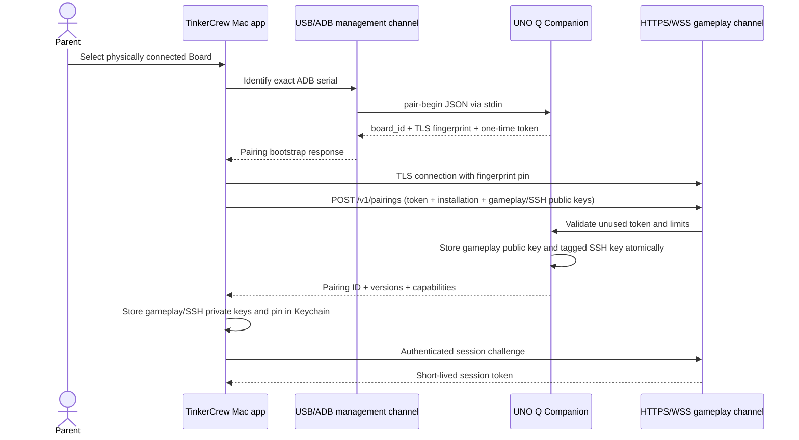

# Secure Mac-to-UNO-Q protocol and pairing proposal

Status: proposed for issue #3  
Protocol name: **TinkerCrew Board Protocol (TBP)**  
Initial version: **1.0**

## Decision summary

TinkerCrew uses two deliberately separate channels:

1. **Management channel** — direct USB/ADB for installation and recovery, then dedicated-key SSH for parent-approved maintenance. It is never exposed to mission logic.
2. **Gameplay channel** — HTTPS for request/response operations and WebSocket Secure (`wss`) for live Observables. It exposes only a bounded Companion API and never arbitrary shell execution.

Pairing requires physical USB access. During Pairing, the Mac pins the Board's self-signed TLS identity and registers a dedicated application public key. Normal gameplay then authenticates every HTTP and WebSocket connection over TLS. The design is local-only and does not require a cloud account, public certificate authority, internet connection, or shared Linux password.

## Goals and non-goals

### Goals

- Authenticate the Mac before returning private Observables or accepting any Command.
- Bind credentials to a specific Board identity.
- Keep gameplay independent from Linux shell access.
- Recover and revoke trust through direct USB.
- Make protocol compatibility and degraded hardware health explicit.
- Put strict limits around sound, light, message size, and request rate.
- Operate on a home, guest, or school LAN without internet access.

### Non-goals

- Remote access across the internet
- Cloud identity or telemetry
- General remote shell execution through TBP
- Automatic operating-system updates
- Publicly trusted TLS certificates or DNS ownership
- Judging physical builds or creative choices

## Trust and identity model

### Board identity

On first Companion initialization, the Board generates:

- `board_id`: 128 random bits, encoded as lowercase UUID text;
- an Ed25519 device identity key;
- a self-signed TLS certificate containing `board_id` in a URI Subject Alternative Name;
- a certificate validity period of 397 days, renewed before expiry while retaining the device identity key.

The private key remains on the Board with owner-only permissions. The Mac does not trust the certificate because it is self-signed; it trusts the exact certificate/public-key fingerprint learned over physical USB during Pairing.

A factory reset creates a new `board_id` and device identity. A hostname change does not.

### Mac installation identity

Each TinkerCrew installation generates:

- `installation_id`: 128 random bits, encoded as lowercase UUID text;
- one Ed25519 gameplay authentication key pair;
- one separate dedicated Ed25519 SSH key pair for Board management.

The installation ID is not a person or child identifier. It labels a revocable installation credential.

### Storage

Store in macOS Keychain, accessible only to the signed TinkerCrew application:

- gameplay authentication private key;
- pinned Board identity/fingerprint;
- dedicated SSH private key;
- Board ID, display name, and last validated addresses.

The gameplay and SSH public keys may be stored in ordinary application data. The Board stores:

- the gameplay authentication public key;
- installation ID, label, creation time, last-use time, and revocation state;
- the dedicated SSH public key, tagged with the installation ID;
- device identity private key and certificate.

No Linux password is stored after setup. If a supported provisioning step temporarily needs a password, it is accepted through an interactive or stdin-only path, held in memory for the shortest possible time, and excluded from logs and process arguments.

## Initial Pairing flow

Pairing uses USB as the trust bootstrap. The one-time token prevents an unrelated local client from racing the network portion while the parent has the Board connected.

1. Parent connects and explicitly selects one Board over USB.
2. TinkerCrew verifies a stable ADB serial and refuses ambiguous multi-device state.
3. TinkerCrew invokes a fixed Companion Pairing command over USB, with request JSON on stdin.
4. The Companion creates a cryptographically random 256-bit Pairing token that expires after 5 minutes and one successful use.
5. The USB response returns `board_id`, certificate fingerprint, Pairing token, Companion address candidates, and protocol versions.
6. TinkerCrew opens HTTPS to an address whose presented certificate matches the USB fingerprint.
7. TinkerCrew submits the Pairing token, installation ID, gameplay authentication public key, and dedicated SSH public key.
8. The Companion atomically stores the gameplay public key and appends the tagged SSH public key without replacing unrelated keys.
9. The Companion consumes the token and returns the Pairing record ID and capability summary.
10. TinkerCrew stores its secrets in Keychain, closes the USB Pairing operation, and starts a normal authenticated Control session.

If network setup is unavailable, step 6 may use an ADB port-forwarded loopback connection. The resulting Pairing remains valid when the Board later appears on the LAN.

### Pairing sequence



### Pairing bootstrap request over stdin

```json
{
  "operation": "pair_begin",
  "installation_id": "1f33fd77-7015-41c6-a882-650f37a06c18",
  "installation_label": "Family MacBook"
}
```

### Pairing bootstrap response over stdout

```json
{
  "board_id": "98f6411f-20ec-438a-a1de-6ce20fb0370e",
  "board_name": "dragon-den",
  "tls_spki_sha256": "m8vV7mBtbQ8NtmYJ8z9Z8DpdKZHeML7cl2lPMcdyLhs=",
  "pairing_token": "<base64url 32 random bytes>",
  "expires_at": "2026-10-22T23:15:00Z",
  "addresses": ["https://dragon-den.local:7443"],
  "protocol_versions": ["1.0"]
}
```

## Gameplay authentication

### Opening a Control session

The long-lived gameplay private key is used only to prove possession and obtain a short-lived session token:

1. Client sends `POST /v1/sessions/challenge` with Board ID and installation ID.
2. Companion returns a random 256-bit nonce valid for 30 seconds and one attempt.
3. Client signs the canonical challenge with its Ed25519 gameplay authentication private key.
4. Client sends the signature to `POST /v1/sessions`.
5. Companion verifies it with the stored public key and returns a random opaque session token valid for 15 minutes, idle timeout 2 minutes.

The canonical challenge is UTF-8:

```text
TBP1\n<board_id>\n<installation_id>\n<challenge_id>\n<base64url_nonce>\n<expires_at>\n
```

HTTP requests use `Authorization: Bearer <session-token>`. The initial WebSocket upgrade uses the same header. Tokens never appear in URLs, query strings, WebSocket messages, or logs.

A session is bound to one Board ID and installation ID. Revoking a Pairing invalidates all its sessions immediately.

### Authorization policy

- All endpoints except `/v1/health/public`, `/v1/sessions/challenge`, and the token-protected Pairing endpoint require authentication.
- `/v1/health/public` returns only Board ID, boot state, and supported protocol major versions—no hostname, network details, Observables, or capabilities.
- Every state-changing Command requires an authenticated session.
- Reading Observables and detailed health also requires authentication.
- Pairing, unpairing other installations, upgrades, reboot, and SSH-key changes are management operations; they are unavailable through the gameplay API.

## Transport and TLS recommendation

### MVP

Use TLS 1.3 where available, with TLS 1.2 as a temporary compatibility floor only if the selected UNO Q runtime cannot provide TLS 1.3. Pin the Board's Subject Public Key Info SHA-256 fingerprint learned over USB. Do not disable certificate verification globally or trust arbitrary self-signed certificates.

TLS is required for the MVP. A bearer/session credential on plaintext HTTP or WebSocket can be observed and replayed by another device on a guest or school network. TLS protects credentials, Commands, and family activity in transit. RFC 6750 requires bearer tokens to be protected in storage and transport; TLS 1.3 is defined by RFC 8446.

No public CA or internet check is required. Certificate expiry, renewal, and pin changes are handled locally:

- renewing a certificate with the same device identity key preserves the SPKI pin;
- changing the identity key requires parent-confirmed USB recovery;
- clock uncertainty before network time is available must not disable pin validation. The app may tolerate certificate wall-clock validity during boot only when the SPKI pin and Board ID match, then report clock health.

### Later releases

Keep TLS and pinning. Consider mutual TLS only if operational experience shows it simplifies—not complicates—credential rotation and recovery. Do not add a cloud certificate service merely to obtain publicly trusted certificates for `.local` names.

## Protocol shape

### HTTP resources

| Method and path | Purpose | Auth | Class |
| --- | --- | --- | --- |
| `GET /v1/health/public` | Minimal discovery probe | No | Discovery |
| `POST /v1/pairings` | Consume one-time USB Pairing token | Pairing token | Management bootstrap |
| `POST /v1/sessions/challenge` | Begin credential proof | Installation ID | Authentication |
| `POST /v1/sessions` | Complete proof and create session | Ed25519 signature | Authentication |
| `DELETE /v1/sessions/current` | End current session | Session | Authentication |
| `GET /v1/hello` | Versions, detailed health, capabilities, limits | Session | Gameplay |
| `POST /v1/self-tests` | Start bounded self-test | Session | Gameplay |
| `GET /v1/self-tests/{id}` | Read self-test state | Session | Gameplay |
| `POST /v1/commands` | Submit one bounded hardware Command | Session | Gameplay |
| `GET /v1/state` | Current outputs and latest Observables | Session | Gameplay |
| `GET /v1/events` | Upgrade to live WebSocket stream | Session | Gameplay |

### Common request envelope

```json
{
  "protocol": "1.0",
  "request_id": "0192b175-0b6f-7fd6-b9e7-b6f2e345bbd0",
  "sent_at": "2026-10-22T23:20:45.123Z",
  "operation": "pixels.set",
  "arguments": {
    "color": "#ff0000",
    "brightness": 0.35,
    "duration_ms": 2000
  }
}
```

- `request_id` is a UUIDv7 generated by the client.
- `sent_at` is advisory for diagnostics; authorization never depends only on the client clock.
- `operation` is an allowlisted string.
- Unknown top-level fields are ignored within a compatible minor version; unknown operations and argument fields are rejected.
- The Companion caches the result of state-changing request IDs for 10 minutes. Repeating the same ID and body returns the original result; repeating the ID with a different body returns `request_id_reused`.

### Success response

```json
{
  "protocol": "1.0",
  "request_id": "0192b175-0b6f-7fd6-b9e7-b6f2e345bbd0",
  "status": "ok",
  "completed_at": "2026-10-22T23:20:45.151Z",
  "result": {
    "accepted_until": "2026-10-22T23:20:47.151Z"
  }
}
```

### Error response

```json
{
  "protocol": "1.0",
  "request_id": "0192b175-0b6f-7fd6-b9e7-b6f2e345bbd0",
  "status": "error",
  "error": {
    "code": "capability_unavailable",
    "message": "Pixels are disconnected.",
    "retryable": true,
    "retry_after_ms": 1000,
    "details": {
      "capability": "pixels",
      "health": "disconnected"
    }
  }
}
```

Error codes are stable machine-readable values. Messages are safe for parent-facing display and contain no secrets, stack traces, filesystem paths, raw commands, or internal exception text.

### Required error codes

- `authentication_required`
- `authentication_failed`
- `pairing_revoked`
- `protocol_incompatible`
- `invalid_message`
- `message_too_large`
- `rate_limited`
- `request_id_reused`
- `capability_unavailable`
- `observable_stale`
- `command_out_of_range`
- `command_timed_out`
- `board_busy`
- `safe_state_active`
- `internal_error`

## Capability and health discovery

`GET /v1/hello` returns the contract for the connected Board rather than making the Mac assume hardware exists.

```json
{
  "protocol": "1.0",
  "board": {
    "board_id": "98f6411f-20ec-438a-a1de-6ce20fb0370e",
    "model": "arduino-uno-q",
    "name": "dragon-den"
  },
  "versions": {
    "companion": "0.1.0",
    "firmware": "0.1.0",
    "protocol": "1.0"
  },
  "health": {
    "state": "ready",
    "uptime_ms": 38422,
    "safe_state": false
  },
  "capabilities": [
    {
      "id": "distance",
      "kind": "observable",
      "health": "operational",
      "unit": "millimeter",
      "minimum": 20,
      "maximum": 4000,
      "sample_rate_hz": 10,
      "stale_after_ms": 750
    },
    {
      "id": "buzzer",
      "kind": "output",
      "health": "operational",
      "limits": {
        "minimum_hz": 100,
        "maximum_hz": 4000,
        "maximum_duration_ms": 3000,
        "duty_cycle_per_minute": 0.2
      }
    }
  ],
  "limits": {
    "maximum_message_bytes": 65536,
    "maximum_commands_per_second": 20,
    "maximum_connections": 2
  }
}
```

Capability health values:

- `operational` — available and fresh;
- `stale` — connected but no fresh reading within `stale_after_ms`;
- `disconnected` — expected hardware cannot be reached;
- `degraded` — usable with a reported limitation;
- `unsupported` — unavailable in this hardware/firmware combination.

Board health values:

- `booting`
- `ready`
- `degraded`
- `updating`
- `safe_state`
- `shutting_down`

## WebSocket Observables

The authenticated WebSocket sends server-to-client events. Client-to-server traffic is limited to acknowledgements, subscription changes, ping/pong, and session close; hardware Commands remain HTTP requests with idempotent request IDs.

### Event envelope

```json
{
  "protocol": "1.0",
  "event_id": "0192b179-54c6-7efb-a979-548352719f58",
  "sequence": 1842,
  "observed_at": "2026-10-22T23:21:02.455Z",
  "monotonic_ms": 39018,
  "type": "distance.changed",
  "capability": "distance",
  "health": "operational",
  "payload": {
    "millimeters": 428
  }
}
```

Rules:

- `sequence` increases per Companion boot and may reset only when `boot_id` changes.
- `/v1/hello` and the initial WebSocket `connected` event include a random `boot_id`.
- `observed_at` is wall-clock diagnostic time; `monotonic_ms` and receipt time determine freshness.
- The Companion emits explicit health events when an Observable becomes stale, disconnected, operational, or degraded.
- Distance samples may be coalesced to the negotiated rate. Button edges are never silently coalesced.
- The server sends a heartbeat every 5 seconds. Missing two heartbeats makes the Mac mark the Control session interrupted and all Observables stale.

### Stale event

```json
{
  "protocol": "1.0",
  "event_id": "0192b17b-8f17-7a41-9583-f5ab93c623c2",
  "sequence": 1849,
  "observed_at": "2026-10-22T23:21:04.001Z",
  "monotonic_ms": 40564,
  "type": "capability.health_changed",
  "capability": "distance",
  "health": "stale",
  "payload": {
    "last_fresh_monotonic_ms": 39780,
    "stale_after_ms": 750
  }
}
```

## Bounded Commands

The Companion validates every Command independently of the Mac UI.

Required limits include:

- Pixels: validated color format, brightness `0.0..0.5` for beginner missions unless a capability advertises otherwise, bounded pattern duration.
- Buzzer: advertised frequency range, maximum 3-second single tone, maximum pattern duration, and rolling duty-cycle limit.
- Matrix: fixed dimensions, bounded frame count and update rate, no arbitrary binary payload.
- All outputs: expiration or lease duration; no indefinite output without periodic authenticated renewal.

When the controlling session disconnects, misses its lease, is revoked, or violates a safety limit, the Companion enters Safe state: buzzer off, pixels at the documented safe indication or off, matrix non-alarming, and pending patterns cancelled.

Example Buzzer Command:

```json
{
  "protocol": "1.0",
  "request_id": "0192b180-e1de-747e-8613-3ae5b6de2fea",
  "sent_at": "2026-10-22T23:21:25.000Z",
  "operation": "buzzer.play",
  "arguments": {
    "frequency_hz": 440,
    "duration_ms": 300,
    "volume": 0.25
  }
}
```

## Limits and abuse handling

Defaults may be lowered by the Companion and are advertised by `/v1/hello`.

| Limit | Default |
| --- | ---: |
| HTTP request body | 64 KiB |
| WebSocket message | 32 KiB |
| Pairing request body | 16 KiB |
| Concurrent authenticated connections | 2 |
| Concurrent controlling sessions | 1 |
| Commands | 20/second burst, 10/second sustained |
| Session challenge attempts | 5/minute/installation and 20/minute/source address |
| Pairing attempts | 5 per token; then token invalidated |
| Self-test duration | 60 seconds |
| HTTP operation timeout | 5 seconds unless operation documents less |
| Command queue depth | 32; excess rejected |
| Event backlog | 256 events; overflow produces `events.dropped` |

Malformed, oversized, or rate-limited input is rejected before hardware access. Repeated authentication failures add bounded delay but never expose whether a revoked credential once existed.

## Reconnection behavior

1. Mark the Control session interrupted immediately on socket error or missed heartbeat.
2. Stop issuing Commands and mark all Observables stale.
3. The Companion independently enters Safe state when its control lease expires, no later than 2 seconds after loss.
4. Retry the last validated address, then discovery/fallback logic from issue #7.
5. Use exponential backoff with jitter: 500 ms, 1 s, 2 s, 4 s, 8 s, then 15–30 s.
6. Re-establish TLS pin validation and create a new session; session tokens are never resumed across a transport break.
7. Fetch `/v1/hello` and `/v1/state` before accepting new mission Commands.
8. Compare `boot_id`, versions, capabilities, and output state. Do not replay old Commands automatically.

## Protocol compatibility

Version format is `MAJOR.MINOR`.

- A major version changes when message meaning or required behavior is incompatible.
- A minor version adds optional operations, fields, events, or error codes.
- Client sends the highest version it supports.
- Companion returns its selected version or `protocol_incompatible` with supported major/minor ranges.
- Within one major version, receivers ignore unknown optional top-level fields but reject unknown required operations and invalid argument fields.
- Capabilities, not version guesses, determine whether hardware behavior is available.

The Mac application bundles an explicit compatibility table. It must not “try anyway” across unsupported major versions. Updates are parent-approved and remain possible through the management channel when gameplay versions are incompatible.

## Unpairing and recovery

### Lost Mac

A parent connects the Board over USB and lists Pairing records using a fixed management command. They select the lost installation by label, creation date, and last use, then revoke it. Revocation deletes its gameplay authentication public key, removes only its tagged SSH key, and terminates its sessions. No Mac secret is needed.

### Reinstalled Mac application

A reinstall has no gameplay private key if the Keychain item was removed. The parent repeats physical USB Pairing as a new installation. The old Pairing may be revoked during the flow. TinkerCrew never recovers or exports the old private key.

### Lost or reset Board

A factory-reset Board has a new Board ID and TLS identity. The Mac treats it as a new Board and requires USB Pairing. It must not accept a hostname match as identity continuity.

### Certificate/key recovery

An unexpected TLS pin change blocks network control. Parent-confirmed USB inspection may show the new fingerprint and reason. Trust is replaced only through a new or explicit recovery Pairing operation.

## Logging and secret handling

Use structured logs with an allowlist of fields. Permitted examples: request ID, operation name, Board ID suffix, protocol version, durations, status/error code, capability health, byte counts.

Always redact or omit:

- Pairing and session tokens;
- gameplay private keys, challenge signatures, and session tokens;
- SSH private keys and Linux passwords;
- `Authorization`, `Cookie`, and WebSocket authentication headers;
- request bodies for authentication and Pairing endpoints;
- raw shell commands and environment variables;
- Wi-Fi SSIDs/passwords unless an explicitly parent-visible diagnostic requires the SSID.

Redaction occurs before values reach any logging API. Debug mode does not weaken this rule. Crash reports remain local for the MVP and apply the same allowlist.

## Threat model

| Threat | Example | Mitigation | Residual risk |
| --- | --- | --- | --- |
| Passive LAN observer | Guest-network user captures gameplay traffic | TLS, no tokens in URLs, authenticated Observables | Traffic timing and destination remain visible |
| Active LAN attacker | Attacker impersonates `dragon-den.local` | USB-learned SPKI pin and Board ID; reject hostname-only trust | Physical USB compromise can replace trust |
| Unauthorized controller | Another app sends buzzer or pixel Commands | Auth required for all detailed reads and state changes; installation-specific signing key; rate limits | Malware running as the same macOS user may target app memory |
| Pairing race | LAN client uses token before TinkerCrew | Token transferred over USB, short expiry, certificate pin, attempt limit, atomic single use | Compromised Board or Mac defeats bootstrap |
| Credential theft from disk | User copies app data | Private keys in Keychain; Board stores only public keys | Unlocked compromised Mac can use credentials |
| Lost Mac | Old installation remains authorized | USB listing and revocation; tagged SSH keys; session invalidation | Revocation requires physical Board access |
| Malicious/compromised Companion | Board sends malformed or huge events | Strict schemas, size limits, bounded queues, timeouts, no shell in gameplay adapter | Board can falsify its own hardware readings |
| Command flood | Bug loops alarm Commands | Per-session/global rate and duty-cycle limits; bounded queue; Safe state | Allowed limits may still be annoying; tune with play tests |
| Replay | Captured Command is resent | TLS, short sessions, idempotent request IDs, request-ID/body binding | Replay inside a currently compromised session remains possible |
| Multiple Boards | Command reaches the wrong Board | Board ID in trust record and session challenge; exact serial for USB | Parent can still select the wrong Board deliberately |
| Version downgrade | Attacker forces weaker protocol | TLS-protected negotiation, pinned identity, supported-major floor | Locally installed old software may legitimately lack fixes |
| Secret leakage in diagnostics | Token printed in error or stack trace | Allowlist logging and pre-log redaction; safe error model | New fields require review to remain excluded |
| Output left active | Wi-Fi or app disappears while buzzer runs | Output leases and Companion-enforced Safe state within 2 seconds | Board power/electrical faults are outside protocol control |

## Security invariants for implementation tests

1. No unauthenticated request can read detailed Observables or alter output state.
2. No gameplay request can execute arbitrary shell text.
3. A reused, expired, or over-attempted Pairing token fails.
4. A session challenge and token are single-use/short-lived as specified.
5. A TLS certificate with the wrong pin fails even when hostname and Board name match.
6. Revocation terminates active sessions and removes only the selected tagged SSH key.
7. Disconnect or lease expiry reaches Safe state within 2 seconds.
8. Oversized and over-rate messages are rejected before hardware handling.
9. Logs contain none of the seeded test secrets.
10. An unsupported major version produces a compatibility error and no Commands.

## Open implementation questions

These do not change the protocol boundary but require spikes:

- Which UNO Q TLS library/runtime provides acceptable TLS 1.3 performance?
- Can the device identity private key use hardware-backed storage, or only owner-protected Linux storage?
- Which Keychain access-control mode gives reliable background reconnect without repeated prompts?
- Does USB Pairing use ADB port forwarding or a fixed stdin/stdout Companion CLI on every supported system image?
- What exact electrical-safe pixel brightness and buzzer duty limits should hardware QA establish?

## Standards references

- RFC 8446, **The Transport Layer Security (TLS) Protocol Version 1.3**: https://www.rfc-editor.org/rfc/rfc8446
- RFC 6750, **OAuth 2.0 Bearer Token Usage**, especially bearer-token transport threats: https://www.rfc-editor.org/rfc/rfc6750
- RFC 8259, **The JavaScript Object Notation (JSON) Data Interchange Format**: https://www.rfc-editor.org/rfc/rfc8259
- RFC 6455, **The WebSocket Protocol**: https://www.rfc-editor.org/rfc/rfc6455
- Apple, **Keychain Services**: https://developer.apple.com/documentation/security/keychain-services
